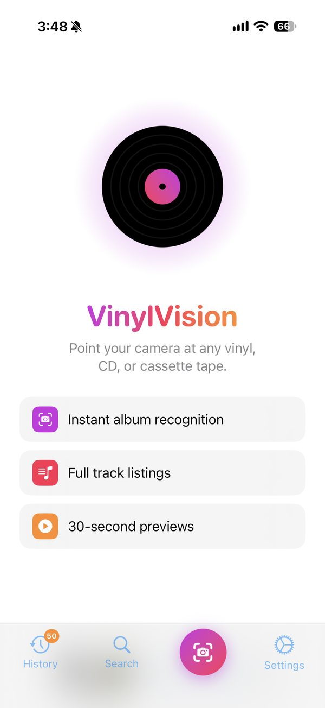
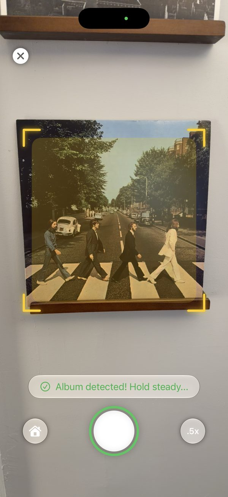
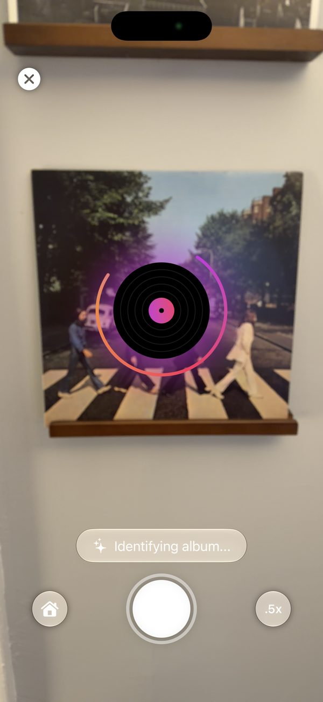
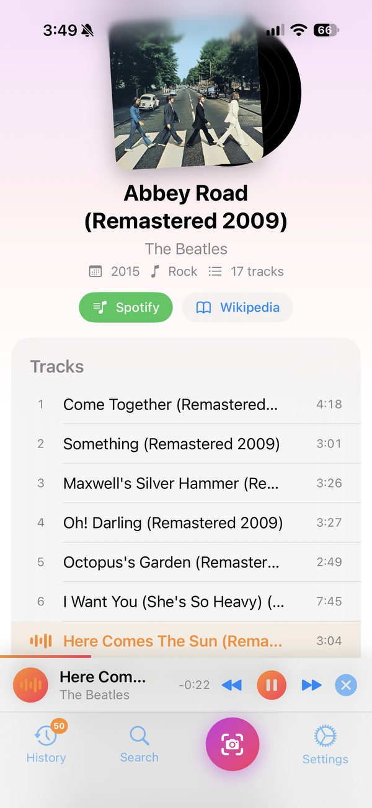

<div align="center">

# VinylVision

**Point your camera at any vinyl, CD, or cassette tape and see what it is.**

VinylVision recognizes physical music from its cover art, then shows you the album, its full track list, and 30-second previews you can play on the spot.

**Coming soon to the App Store** · iPhone & iPad · Apple Vision Pro (later)

</div>

<p align="center">
  
  &nbsp;
  
  &nbsp;
  
  &nbsp;
  
</p>

## Features

- **Instant album recognition.** A live camera finder locks onto the album cover, tells you to hold steady, and identifies it in seconds. Works with vinyl sleeves, CD cases, and cassette J-cards.
- **Full track listings.** See the album title, artist, release year, genre, track count, and every track with its running time.
- **30-second previews.** Tap any track to hear a preview. A persistent Now Playing bar keeps playback going while you browse, with skip and close controls.
- **Jump out to more.** One tap opens the album in Spotify or Apple Music (your choice), or its Wikipedia article.
- **History.** Your last 50 scanned albums are saved so you can come back to them.
- **Manual search.** If the camera can't make a match, search for the album by name instead.

## How it works

1. **Capture.** The camera feed runs Apple's Vision framework rectangle detection to find the album cover and crop it.
2. **Recognize.** The cropped image goes to Google Cloud Vision (web detection and OCR) to read text and find visual matches, and the results are scored for how likely they are to be music.
3. **Match.** The best candidate is looked up on Discogs for release metadata.
4. **Listen.** Track previews and artwork come from Deezer.

## Requirements

- iOS / iPadOS 27.0 or later
- Xcode 26.5 or later to build from source
- API credentials for Google Cloud Vision and Discogs (see below)

## Building from source

```bash
git clone https://github.com/JesseSheehan/VinylVision.git
cd VinylVision
open VinylVision.xcodeproj
```

API keys live in `Secrets.xcconfig`, which is not committed. Create it in the project root:

```
// Secrets.xcconfig  (do not commit)
GOOGLE_CLOUD_VISION_API_KEY = your_key_here
DISCOGS_TOKEN = your_token_here
```

<!-- TODO: confirm exact key names used in Info.plist -->
The values are exposed through Info.plist and read at runtime with `Bundle.main.object(forInfoDictionaryKey:)`. Then select your device or simulator and press **⌘R**. Camera scanning needs a real device.

## Apple Vision Pro

A visionOS version is in development. Live camera scanning on Vision Pro currently depends on Apple's `CameraFrameProvider` API, which is limited to enterprise developers, so the visionOS release will follow once that access opens up.

## Roadmap

- Smarter cover recognition for art-only covers with no text
- Barcode scanning for CDs
- More precise release matching (specific pressings and remasters)
- visionOS release

## Privacy

Camera frames are used only to identify the album in front of you. The cropped cover image is sent to Google Cloud Vision for recognition. A full privacy policy will be published with the App Store release.

## Credits

All album and track information comes from [Discogs](https://www.discogs.com) and [Deezer](https://www.deezer.com), and previews are streamed from Deezer. Spotify and Apple Music are used only as outbound links. Image recognition by [Google Cloud Vision](https://cloud.google.com/vision). VinylVision is not affiliated with or endorsed by these services.

## License

© 2026 Jesse Sheehan. All rights reserved.

The source is public for reference, but no license is granted to copy, modify, or redistribute it.
